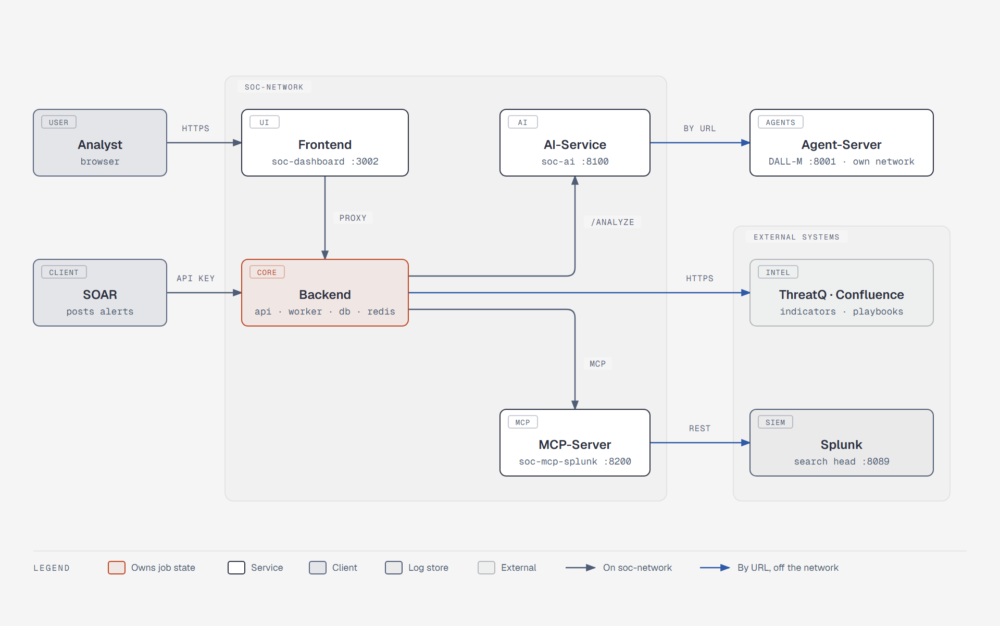

# AI-Service

`soc-ai` does two jobs, both for the Backend:

1. **Runs an agent.** It takes a finished prompt, asks Agent-Server to run a
   named agent on it, and returns the answer.
2. **Matches playbooks.** The Backend sends it the Confluence pages. It indexes
   them and answers "which playbook covers this alert".

It has no database, no queue and no users. The one thing it keeps is the
playbook index, a single file on the `playbook-index` volume. FastAPI.



## Run

```bash
docker network create soc-network     # once
cp .env.example .env                  # set AI_SERVICE_AUTH_TOKEN, same value as Backend/.env
docker compose up -d --build
```

No port is published: only the Backend calls this service, over `soc-network`.
Check it from inside the container:

```bash
docker exec soc-ai python -c "import urllib.request; print(urllib.request.urlopen('http://localhost:8100/health').read())"
```

`/health` answers 200 even when Agent-Server is unreachable. Read the body:
`"llm_server": false` means it cannot reach Agent-Server.

## API

Every route except `/health` needs `Authorization: Bearer $AI_SERVICE_AUTH_TOKEN`.

| Route | Purpose |
| --- | --- |
| `POST /analyze` | Run an agent on `rendered_prompt`. Returns the response and token counts. |
| `POST /llm-probe` | Same body. Returns the request sent and the raw stream, for debugging. |
| `PUT /playbooks/index` | Replace the playbook index with the given pages. |
| `POST /playbooks/match` | Find the playbook for an alert name. |
| `GET /playbooks` | Show what is indexed. |
| `GET /health` | Liveness, and whether Agent-Server answers. |

## Playbook matching

Three tiers, cheapest first. A later tier runs only when the earlier one finds
nothing.

| Tier | Matches | Setting |
| --- | --- | --- |
| `exact` | The name or an alias. | — |
| `fuzzy` | A renamed detection, by spelling. | `PLAYBOOK_FUZZY_CUTOFF` |
| `semantic` | Different words for the same detection, by embedding. | `PLAYBOOK_SEMANTIC_MIN_SCORE`, `PLAYBOOK_SEMANTIC_MIN_MARGIN` |

`PLAYBOOK_SEMANTIC=false` turns the third tier off and loads no model.

## Connecting to Agent-Server

| Variable | Default | Meaning |
| --- | --- | --- |
| `LLM_SERVER_URL` | `http://host.docker.internal:8001` | Agent-Server's API. |
| `LLM_RUN_PATH` | `/v1/agents/{agent}/chat` | The route that runs an agent. |
| `LLM_DEFAULT_AGENT` | `soc-suggest` | The agent used when a request names none. |

The agents `soc-suggest`, `soc-requirements` and `soc-conclude` must exist in
Agent-Server and be active. Nothing in this repo creates them.

## Tests

```bash
pip install -r requirements.txt -r tests/requirements.txt
pytest -q
```

The tests need no model and no Agent-Server.

## More

- Matching calibration, production checklist, port hardening: [docs/reference.md](docs/reference.md)
- The whole system: [../README.md](../README.md)
